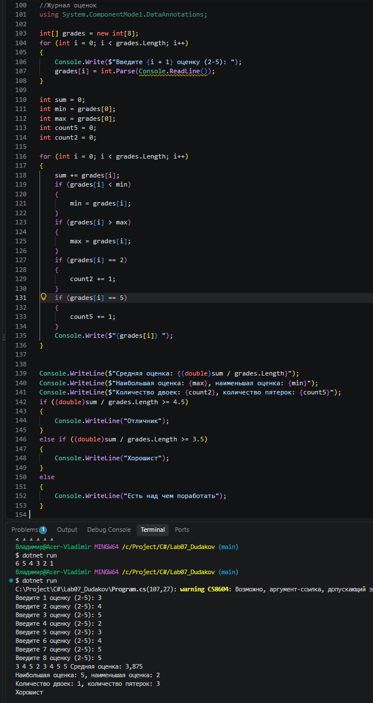
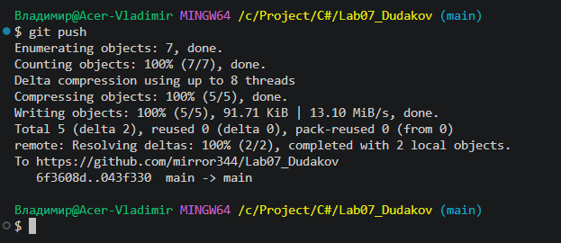

# Практическая работа №7
**ФИО: Дудаков Иван**
**Группа: ИСП-241**
**Дата: 10.10.2026**
## Что изучено
- Создание массивов. Элементы массивов нумернуются с нуля, при обращении к несущестующему индексу программа завершится с ошибкой `IndexOutOfRangeException`
- Метод Length выдает количество элементов
- Цикл `foreach` используется для чтения элементов массива, для всех остальных действий используется цикл `for`

## Скриншоты

